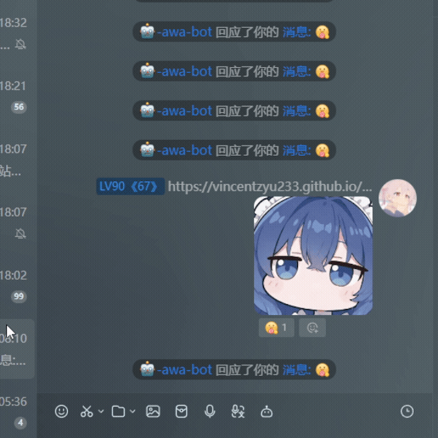
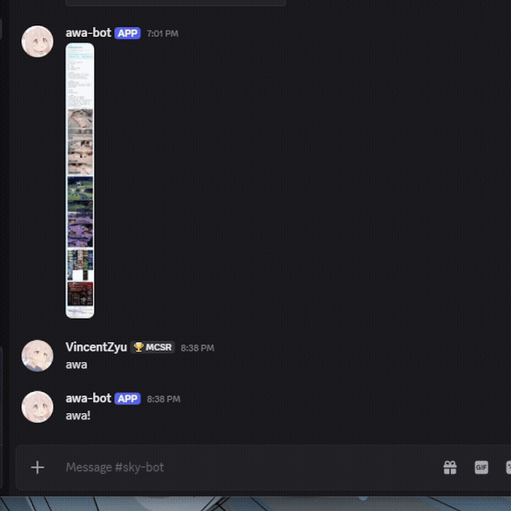

> 💡 推荐前往 [GitHub](https://github.com/VincentZyuApps/koishi-plugin-let-me-quote-and-recall) 或 [Gitee](https://gitee.com/vincent-zyu/koishi-plugin-let-me-quote-and-recall) 阅读 README，体验更好。

> **[📖 查看完整更新日志 →](./CHANGELOG.md)**


# 💬 koishi-plugin-let-me-quote-and-recall

[](https://www.npmjs.com/package/koishi-plugin-let-me-quote-and-recall)
[](https://npm-stat.com/charts.html?package=koishi-plugin-let-me-quote-and-recall)

[](https://github.com/VincentZyuApps/koishi-plugin-let-me-quote-and-recall)
[](https://gitee.com/vincent-zyu/koishi-plugin-let-me-quote-and-recall)

[](https://forum.koishi.xyz/t/topic/13788)

[](https://qm.qq.com/q/ZHj33L5cuC)

<h2>💬 交流反馈</h2>
<p>🐛 Bug 反馈 / 💡 建议 / 👨‍💻 插件开发交流，欢迎加群：</p>
<p><del>💬 插件使用问题 / 🐛 Bug反馈 / 👨‍💻 插件开发交流，欢迎加入QQ群：<b>259248174</b>   🎉（这个群G了）</del></p> 
<p>💬 插件使用问题 / 🐛 Bug反馈 / 👨‍💻 插件开发交流，欢迎加入QQ群：<b>1085190201</b> 🎉</p>
<p>💡 在群里直接艾特我，回复的更快哦~ ✨</p>

💬 智能为指令回复添加引用 ⚡ 并在指令被撤回时联动撤回 Bot 消息 🔄

> [!WARNING]
> ### ⚠️ 平台兼容性与功能支持矩阵
> 本插件经**作者实机测试**在各主流平台的兼容性表现如下：**指令自动引用 (Quote) 在所有测试平台均可完美生效**；而**指令联动撤回 (Recall)** 则受各聊天平台底层开放协议与网关事件机制的客观限制，支持情况存在差异：
> 
> | 协议端 / 平台 | 指令自动引用 (Quote) | 指令联动撤回 (Recall) | 实测说明与协议原因 |
> | :--- | :---: | :---: | :--- |
> | **OneBot (QQ 协议端)** | ✅ 支持 | ✅ 支持 | 实测完美支持！具备完整的消息引用与群聊/私聊撤回事件通知 |
> | **QQ 官方 Bot (群聊/私聊)** | ✅ 支持 | ❌ 不支持 | 自动引用回复实测完美支持！但腾讯开放平台网关**不下发任何消息撤回（Delete）事件**，Bot 无法感知撤回动作 |
> | **Discord** | ✅ 支持 | ✅ 支持 | 实测完美支持！Gateway 具备原生 `MESSAGE_DELETE` 事件与消息引用 |
> | **Telegram (官方 Bot API)** | ✅ 支持 | ❌ 不支持 | 引用回复正常；但 [Telegram 官方 Bot API](https://core.telegram.org/bots/api#update) **从不下发消息删除事件**，Bot 无法感知撤回动作 |
> 
> 🔗 **协议调研与源码行数证据**：详见 [Issue #1](https://github.com/VincentZyuApps/koishi-plugin-let-me-quote-and-recall/issues/1)

## 📺 效果预览

### 🤖 OneBot 效果预览



### 🎮 Discord 效果预览



## 🌟 功能特性

1. **指令自动引用 (Quote)**
   - 智能识别指令触发消息（普通聊天、定时广播等非指令出站消息不会受影响）。
   - 提供单选控制策略：
     - **完全不引用 (A)**：保持原样，不自动补充任何引用。
     - **缺省时引用 (B)**：如果插件或指令准备发出的消息未包含 `quote`，自动前置补充对指令消息的引用；若已有 `quote` 则不重复添加。
     - **强制引用 (C)**：无论原回复是否包含 `quote`，均强制前置引用触发指令的消息。

2. **指令撤回联动 (Recall)**
   - 当用户撤回了触发指令的原始消息时，Bot 会自动查找并撤回回复该指令的所有消息。
   - **双重缓存防护**：内置 FIFO/LRU 空间容量上限 + TTL 时间主动过期，杜绝刷屏导致的内存膨胀。
   - 支持设置撤回延迟，防止部分平台动画或网络竞态问题。

3. **场景细粒度控制 (Scenes)**
   - 支持多选框控制生效场景：**群聊 (`group`)** 与 **私聊 (`direct`)**。
   - 默认群聊与私聊全部开启。

## ⚙️ 配置项说明

| 配置项 | 类型 | 默认值 | 说明 |
| :--- | :--- | :--- | :--- |
| `quoteMode` | `'never' \| 'if-missing' \| 'always'` | `'if-missing'` | 指令回复引用策略 (A/B/C 三档单选) |
| `autoRecall` | `boolean` | `true` | 是否在指令被撤回时联动撤回回复 |
| `recallDelay` | `number` | `0` | 联动撤回延迟时间（毫秒，0 为即时） |
| `maxEntries` | `number` | `1000` | 内存中最多保留的指令映射数量（条，防刷屏熔断保护） |
| `expireTime` | `number` | `180` | 指令映射最长保留时长（秒，默认 3 分钟，对齐平台撤回窗口） |
| `enabledScenes` | `('group' \| 'direct')[]` | `['group', 'direct']` | 插件生效场景多选 (群聊 / 私聊，默认全开) |
| `debug` | `boolean` | `false` | 是否开启详细控制台调试日志 |

## 💡 实现原理

插件基于 Koishi 的事件机制与上下文拦截实现，无缝兼容所有业务指令：

### 1. 智能引用回复 (Quote)

在 Bot 发送消息前拦截会话，识别当前是否处于指令执行流，并根据策略动态在消息内容前置拼入引用元素：

```ts
// 拦截发信：在指令回复头部注入原消息引用
ctx.before('send', (session) => {
  if (isCommandSession(session) && shouldQuote(session)) {
    session.elements.unshift(h.quote(session.messageId))
  }
})
```

> 🔗 **Satori 源码定义**：
> - [`before-send` 发信拦截流程：`packages/core/src/message.ts#L33-L54` (`db22bb3`)](https://github.com/satorijs/satori/blob/db22bb3c22f8ee9f6d9d9ecf04fd58b70006956f/packages/core/src/message.ts#L33-L54)
> - [`before-send` 事件类型声明：`packages/core/src/index.ts#L63` (`db22bb3`)](https://github.com/satorijs/satori/blob/db22bb3c22f8ee9f6d9d9ecf04fd58b70006956f/packages/core/src/index.ts#L63)

### 2. 指令撤回联动 (Recall)

建立指令消息与 Bot 回复的映射索引，监听平台的撤回事件时，级联撤回对应的所有 Bot 消息：

```ts
const recallMap = new Map<string, string[]>() // userMsgId -> [botMsgIds]

// ① 发送回复时：记录原指令与 Bot 回复的关联
ctx.on('send', (session) => {
  recallMap.get(userMsgId)?.push(botMsgId)
})

// ② 监听到撤回事件：级联删除 Bot 发送的消息
ctx.on('message-deleted', async (session) => {
  const botMsgIds = recallMap.get(session.messageId)
  if (botMsgIds?.length) {
    await Promise.all(botMsgIds.map(id => session.bot.deleteMessage(session.channelId, id)))
    recallMap.delete(session.messageId)
  }
})
```

> 🔗 **Satori 源码定义**：
> - [`message-deleted` 协议规范事件：`packages/protocol/src/index.ts#L349-L366` (`db22bb3`)](https://github.com/satorijs/satori/blob/db22bb3c22f8ee9f6d9d9ecf04fd58b70006956f/packages/protocol/src/index.ts#L349-L366)
> - [`message-deleted` 事件分发声明：`packages/core/src/index.ts#L42` (`db22bb3`)](https://github.com/satorijs/satori/blob/db22bb3c22f8ee9f6d9d9ecf04fd58b70006956f/packages/core/src/index.ts#L42)

## 📄 授权许可

[MIT License](LICENSE)
